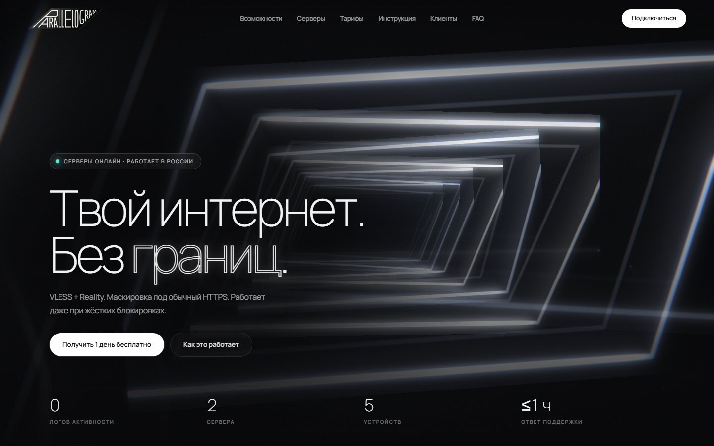

# parallelogram.vpn — новый дизайн

Тот же функционал, новая оболочка. Логика (Firebase, Turnstile, выдача ключа, модалки,
FAQ-аккордеон, тосты) перенесена **без изменений** — блок `<script type="module">`
в `index.html` побайтово совпадает с исходным файлом.

## Что изменилось

Только визуальная часть: вёрстка, CSS, шрифты и новая 3D-сцена в hero.
Все `id`, `onclick`, классы-состояния (`.active`, `.open`, `.show`, `.error`) сохранены —
проверено скриптом: 31 id, 23 обработчика, 75 классов на месте.

| Файл | Назначение |
|---|---|
| `index.html` | Разметка + исходный модуль Firebase (без правок) |
| `styles.css` | Дизайн-система: типографика, сетки, карточки, модалки, адаптив |
| `js/scene.js` | WebGL-сцена hero: гироскоп из параллелограммов, шейдеры, bloom |
| `js/globe.js` | Интерактивный глобус серверов (секция «Серверы») |
| `js/ui.js` | Прелоадер, tilt, магнитные кнопки, скрэмбл, ревилы |
| `js/referral.js` | Партнёрская программа: ссылка, копирование, счётчики |
| `js/referral-net.js` | Привязка приглашения к аккаунту через Firebase-токен |
| `worker/referral.js` | Готовый модуль для воркера: роуты, начисление через H1 |
| `REFERRAL.md` | Как встроить модуль и включить программу |
| `vendor/three.min.js` | Three.js r150, локально |
| `fonts/fonts.css` | Manrope + Cormorant Garamond (кириллица), data URI |
| `logo.png` | Ваш логотип |
| `favicon.svg` | Иконка-параллелограмм (раньше файла не было) |

## Партнёрская программа

Блок «Пригласите друга — неделя в подарок» перед подвалом. Ссылка вида
`?ref=CODE` запоминается на 30 дней, личная ссылка строится из email,
счётчики читаются с воркера.

Начисление делает сервер — пока роуты `/referral/*` не добавлены в воркер,
бейдж автоматически меняется на «скоро», а дни никому не начисляются.
Полная схема и код для вставки — в `REFERRAL.md`.

Превью состояния: `index.html?refdemo=1` (демо-ссылка и цифры, без сети).

## 3D-сцена

Два независимых WebGL-полотна в том же брутальном ч/б неоне.

**Hero — гироскоп.** Вложенные светящиеся параллелограммы в настоящем 3D:
метафора зашифрованного канала, который нельзя остановить.

* объект **можно вращать перетаскиванием** по hero: прямое управление,
  инерция после броска, плавный возврат автовращения;
* рамки — плоскости с SDF-шейдером (контур + свечение + внутренняя линия,
  как на логотипе), каждая на своём наклонном «держателе» с прецессией;
* ядро-светляк в центре гироскопа;
* дальняя аллея рамок-границ: скорость растёт со скроллом, камера реагирует
  на курсор, телеметрия вращения — в углу (`GYRO θ · φ · ω`);
* собственная постобработка: bright-pass → двойной гауссов bloom → композит
  с отражением, виньеткой, зерном и хроматической аберрацией;
* на телефоне сцена перестраивается: меньше рамок, выше и приглушённее;
* деградация качества на слабых GPU и уважение `prefers-reduced-motion`.

**Серверы — глобус.** Каркасная сфера с локациями (NYC, Франкфурт — онлайн;
Амстердам, Хельсинки — «скоро»), дуги трафика с бегущими импульсами,
пульсирующие кольца на онлайн-узлах, живые координаты «центра взгляда».
Вращается перетаскиванием (инерция + автовращение), наведение на карточку
сервера плавно доворачивает глобус к локации. Рендер останавливается,
когда секция вне вьюпорта.

## Интерфейсные фишки v2

* прелоадер: рисующийся параллелограмм + счётчик + «ESTABLISHING SECURE CHANNEL»,
  вход hero-контента каскадом; есть CSS-страховка (сам скрывается за 8 с) и `<noscript>`;
* полоса прогресса скролла, 3D-tilt карточек (возможности/тарифы/клиенты),
  магнитные кнопки, скрэмбл-декодирование тегов секций, редкий глитч контурного
  слова в заголовке.

## Как поставить

1. Скопируйте **содержимое** папки в корень сайта (заменив `index.html`).
2. Остальные файлы (`logo.png`, `terms.html`, `privacy.html`, `favicon.ico`,
   `apple-touch-icon.png`, `og-image.png`) остаются вашими — пути не менялись.
3. Открывать лучше через сервер (хостинг или `python -m http.server`): модульные
   импорты Firebase не работают по `file://`.

## Как менять

* цвета и шрифты — `:root` в начале `styles.css`;
* тексты — `index.html`;
* гироскоп: количество и размер колец — `RING_COUNT`, `size` в `js/scene.js`;
  скорость драга — `DRAG_YAW_K` / `DRAG_PITCH_K`; автовращение — `AUTO_YAW`;
* глобус: локации — объект `NODES`, дуги — вызовы `addArc()` в `js/globe.js`;
* скорость и яркость аллеи — `speed` и множитель `0.4` в цикле `render()`.

## Мелочи

* Если Firebase-модуль не загрузился (нет сети, блокировка CDN), `js/ui.js`
  через 1.5 с подставляет мягкий фолбэк для `scrollToSection` — навигация по разделам
  продолжает работать. В обычном режиме фолбэк не активируется и ничего не переопределяет.
* Навигация подсвечивает активный раздел, карточки ловят блик под курсором.
